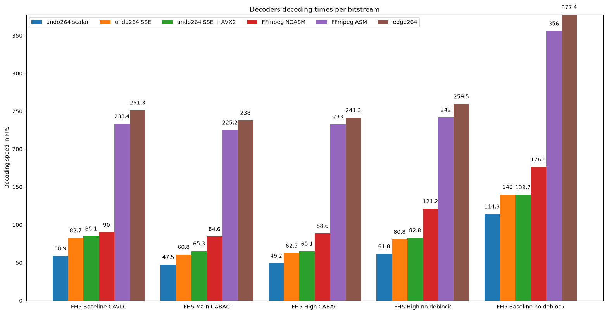
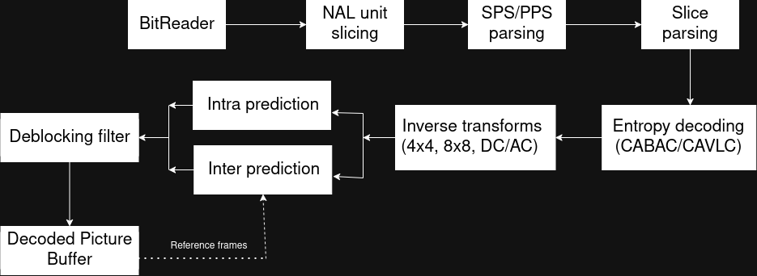
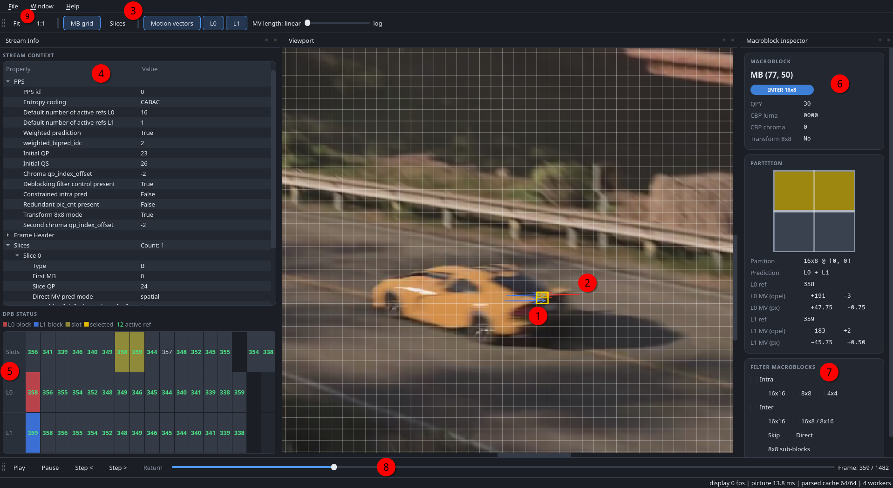

# undo264

A H.264 decoder and viewer written in C


# Features and Scope
Baseline profile, Main and High profile:
- Single threaded
- CAVLC (Context-Adaptive Variable Length Coding)
- CABAC (Context-Adaptive Binary-Arithmetic Coding)
- I/P/B slices
- Weighted prediction
- 8x8 transforms 
- Custom scaling lists
- Deblocking filter
- Memory management control operations (MMCOs)
- Long-term reference pictures
- YUV 4:2:0 and monochrome output

Does and will not support :
- MBAFF/PAFF
- Picture field coding
- FMO (multiple slice groups)
- ASO (arbitrary slice ordering)
- Any format other than 4:2:0 or monochrome
- Profiles: CAVLC 4:4:4, High 10-bit, High 4:2:2, High 4:4:4


# Correctness and Testing

Undo264 gives bit-exact output on all official ITU-T conformance bitstreams for Baseline, Main and High profiles
(AVCv1 and FRExt suites), excluding bitstreams that are out of this decoder's scope. 

A script for downloading the AVCv1 (Baseline, Main) and FRExt (High) suites is available in the test/ folder, 
as well as an automated script to run those test suites 
and compare undo264's output either against given reference decoded files or against FFmpeg's H.264 decoder output, 
which is supposed to be bit-exact. 

To run the test suites in the test/ folder : 
```shell
chmod +x download_vectors.sh && chmod +x conformance_test.sh
./download_vectors.sh # may take a while to download and extract
./conformance_test.sh AVCv1
./conformance_test.sh FRExt
```

# Robustness

Undo264 is not hardened against malformed or malicious bitstreams, though I'm currently running libFuzzer on it,
in order to find bugs and potential vulnerabilities (see Fuzzing section below).  
As this is more of an educational project rather than a decoder intended for production, I will not fix everything
the fuzzer finds. Instead, I will fix and document a few vulnerabilities, again, for educational purposes.


# Benchmarks




*Benchmark computed by medians of 5 runs for each of the 5 bitstreams 
(the Forza Horizon 5 trailer in 1080p, re-encoded with different profiles and settings for each set of runs)*

Below is a table with the decoding speeds in FPS shown above :

|                         |  undo264 scalar  | undo264 SSE   | undo264 SSE+AVX2  |  FFmpeg NOASM  |  FFmpeg ASM  |  edge264  |  
|-------------------------|:----------------:|:-------------:|:-----------------:|:--------------:|:------------:|:---------:|
| FH5 Baseline CAVLC      |       58.9       |     82.7      |       85.1        |       90       |    233.4     |   251.3   |  
| FH5 Main CABAC          |       47.5       |     60.8      |       65.3        |      84.6      |    225.2     |    238    |
| FH5 High CABAC          |       49.2       |     62.5      |       65.1        |      88.6      |     233      |   241.3   |
| FH5 High no deblock     |       61.8       |     80.8      |       82.8        |     121.2      |     242      |   259.5   |
| FH5 Baseline no deblock |      114.3       |      140      |       139.7       |     176.4      |     356      |   377.4   |


# Architecture 

  
*Diagram describing the architecture of H.264 decoding*

The SIMD/scalar functions dispatch is done at runtime, using a DSPContext structure that holds function pointers,
allowing runtime dispatch with CPU features detection. 

# Viewer

A viewer app written by Claude Sonnet 5.5 in Python lets you inspect H.264 stream within this decoder's scope
in an intuitive UI.
Below is a screenshot of the app in use with numbered callouts explaining how to use the app.  

1. **Viewport with a selected macroblock**: clicking selects a macroblock and Ctrl+wheel and middle-drag zoom and pan.  
2. **Motion Vectors**: red for MVs pointing to L0 (past) and blue for L1 (future). Can be toggled with M or the button 
in the top toolbar.
3. **Top toolbar**: Fit frame to the viewport (F), 1:1 frame ratio (1), draw MB grid (G), draw Slice boundaries (S), 
and the MV length slider.
4. **Stream Info tree (left dock)**: the SPS (Sequence Parameter Set), PPS (Picture Parameter Set), Frame Header and Slice Headers 
of the current frame
5. **Decoder Picture Buffer (DPB) table (left dock)**: pictures are numbered using their decoded index. Click a reference
to highlight the blocks in the current frame that use it, double-click to open its header and jump to it.
6. **Macroblock Inspector (right dock)**: type, QP, CBP, the partition map (click a partition) for both Intra and Inter
macroblocks, and the motion vectors in quarter-pel and pixels.
7. **Macroblock filters (right dock)**: they highlight macroblocks by type across the frame.
8. **Transport bar**: with Play, Step, the slider, and return to the active frame after jumping to a
reference frame.
9. **Window menu**: to hide or reopen any dock.

When an Inter macroblock is selected, Shift+Left peeks to the L0 reference block that it uses, by temporarily replacing the 
active frame with the reference frame. Shift+Right does the same for L1.
More key controls are detailed in the Help>Controls dialog.
 

In order to run the app, a H.264 bitstream has to be decoded with undo264 using the ```--dump-info <out>.json``` option,
that dumps the stream info necessary to the viewer.  
Then, run:  
```shell
pip install -r viewer/requirements.txt
python3 viewer/viewer.py
```

One warning: the app indexes all frames in the video file before playing it, which is why I recommend you to use 
short videos (no more than a few minutes) to save you memory, otherwise you will get a very large .json info file, 
and the viewer will consume a lot of memory.
     

# Building

**Requirements:** CMake ≥ 3.20, a C11 compiler (GCC or Clang), and `make`.

## Quick start

```shell
cmake --preset release
cmake --build --preset release -j $(nproc)
cmake --install build/release --prefix /usr/local
undo264 -i <input.264> -o <output.yuv>
```
See ```undo264 --help``` to view command-line options. 

## Presets

| Preset    | Build type         | Purpose                                      |
|-----------|--------------------|----------------------------------------------|
| `release` | Release (`-O3`)    | Normal use                                   |
| `debug`   | Debug + ASan/UBSan | Development and bug hunting (much slower)    |

The resulting binary is tuned to the machine that built it and may crash with an illegal instruction on older CPUs, so don't
build with a preset on one machine and run the binary on another.

## Without presets

```shell
cmake -B build -DCMAKE_BUILD_TYPE=Release
cmake --build build -j
```

Add `-G Ninja` to either configure command if you prefer Ninja over Make.

## Options

Pass with `-D<option>=ON|OFF` at configure time.

| Option            | Default | Effect                                                         |
|-------------------|---------|----------------------------------------------------------------|
| `USE_NATIVE_ARCH` | ON      | Adds `-march=native`. SIMD is currently x86-only; other architectures build and run using the plain C paths. |
| `USE_SANITIZERS`  | OFF     | Builds with ASan + UBSan                                       |
| `BUILD_TOOLS`     | ON      | Also builds `gen_rgb_video` and `compare_streams`              |

## Installing

```shell
cmake --install build/release --prefix /usr/local
```


# Fuzzing

There are numerous ways to fuzz video decoding software like undo264, so feel free to run your own fuzzing setup on it if you want to.
Still, I wrote fuzzing workflow scripts with using AI to automate building and running different fuzz targets, 
as well as automatically generate bug category reports to make it easier to sort, replay, and fix bugs. 

Example commands given below should be run in the fuzzing/ directory.

## Building fuzzers

Fuzzing scripts that use [libFuzzer](https://llvm.org/docs/LibFuzzer.html) are available in the fuzzing/ folder.  
LibFuzzer is bundled into Clang, hence it is required in order to build and run the available scripts.  
Fuzzing targets have separate executables for -O0 and -O3 optimization levels, as well as for sanitizers ASan, UBSan, and MSan.  
For example, to build the fuzzing target for -O3 and ASan only :  
```bash
./build_fuzzers.sh -o 3 -s address
```

## Making seed corpora

Although you can use any set of H.264 videos you want to fuzz undo264, I used and recommend to use the AVCv1 and FRExt
conformance suites, because they have very good coverage (this is the point of the suites).
The make_seed_corpus.sh script takes an output directory, one or several input directories, and searches for H.264
bitstreams inside then, to group them into the output seed directory. 
It discards unsupported bitstreams, because undo264 almost immediately exits with them. This makes fuzzing from them pointless, 
since it would consume precious fuzzing time. 

Example command to make a seed corpus from AVCv1 and FRExt, assuming they have been downloaded and extracted with the 
script test/conformance/download_vectors.sh : 
```bash
./make_seed_corpus.sh seeds/ ../test/conformance/AVCv1 ../test/conformance/FRExt
```

## Running fuzzers

### Manually

Each binary is a normal libFuzzer executable: run it with a corpus directory, e.g.
```bash
mkdir -p crashes/O3/address/some_seeds_name/ corpus/
build/fuzz/O3-address/fuzz_decoder \
        corpus/ \  
        seeds/ \  
        -fork=4 \
        -max_len=65536 \  
        -timeout=10 \  
        -rss_limit_mb=2048 \  
        -runs=1000000 \  
        -artifact_prefix=crashes/O3/address/some_seeds_name/ \ 
        -ignore_crashes=1
```
- ```corpus/```: where libFuzzer places inputs that increase coverage
- ```seeds/```: seed video directory
- ```-fork```: number of child processes to create 
- ```-max_len```: truncation size in bytes of seed inputs
- ```-timeout```: per-input execution time limit in seconds before calling a timeout
- ```-rss_limib_mb```: per-input heap memory limit before calling OOM crash
- ```-runs```: run 1000000 fuzzing iterations, alternatively use -max_total_time=N to run for N seconds
- ```-artifact_prefix```: mutated files that caused a crash goes there
- ```-ignore_crashes```: to avoid libFuzzer exiting when an input causes a crash (only when used with -fork=N)

### With fuzzing script

The run_fuzz.sh script operates as follows : 
1. Builds fuzz targets to run 
2. Runs them so that OOM/timeouts/crashes do not stop the run 
3. Replays crash artifacts one by one and extract their stack trace 
4. Group crash artifacts by their stack trace and save results to report.md  
  
Example run that fuzzes the -O3 build with all ASan, UBSan, and MSan sanitizers: 
```bash
./run_fuzz.sh \ 
  -t 300 \
  -j 4 \
  -S seeds \ 
  -N AVCv1   
```
- ```-t 300```: run for 5 minutes for each target
- ```-j 4```: fork in 4 separate child processes supervised by the parent process
- ```-S seeds/```: input seeds directory
- ```-N AVCv1_and_FRExt```: seeds collection name, used for naming the run directory


# License
MIT, see LICENSE file for details.