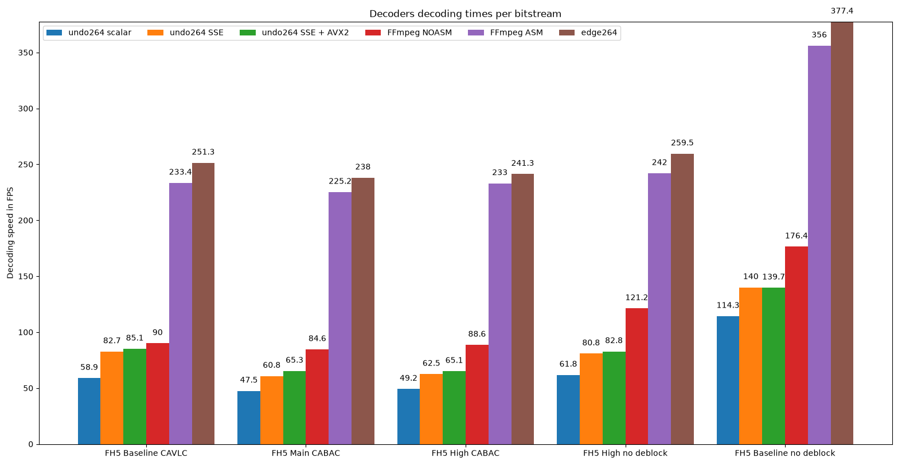
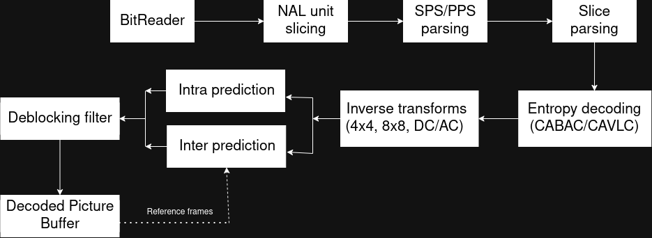
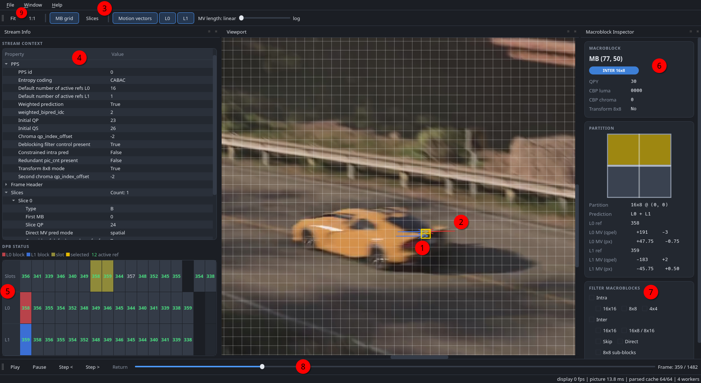

# undo264

A H.264 decoder and viewer written in C


# Features and Scope
Baseline profile, Main and High profile:
- Single threaded
- CAVLC (Context-Adaptive Variable Length Coding)
- CABAC (Context-Adaptive Binary-Arithmetic Coding)
- I/P/B slices
- Weighted prediction
- 8x8 transforms 
- Custom scaling lists
- Deblocking filter
- Memory management control operations (MMCOs)
- Long-term reference pictures
- YUV 4:2:0 and monochrome output

Does and will not support :
- MBAFF/PAFF
- Picture field coding
- FMO (multiple slice groups)
- ASO (arbitrary slice ordering)
- Any format other than 4:2:0 or monochrome
- Profiles: CAVLC 4:4:4, High 10-bit, High 4:2:2, High 4:4:4


# Correctness and Testing

Undo264 gives bit-exact output on all official ITU-T conformance bitstreams for Baseline, Main and High profiles
(AVCv1 and FRExt suites), excluding bitstreams that are out of this decoder's scope. 

A script for downloading the AVCv1 (Baseline, Main) and FRExt (High) suites is available in the test/ folder, 
as well as an automated script to run those test suites 
and compare undo264's output either against given reference decoded files or against FFmpeg's H.264 decoder output, 
which is supposed to be bit-exact. 

To run the test suites in the test/ folder : 
```shell
chmod +x download_vectors.sh && chmod +x conformance_test.sh
./download_vectors.sh # may take a while to download and extract
./conformance_test.sh AVCv1
./conformance_test.sh FRExt
```

# Robustness

Undo264 is not hardened against malformed or malicious bitstreams, though I'm planning to run a fuzzer on it in order 
to find bugs and vulnerabilities.  
As this is more of an educational project rather than a decoder intended for production, I will not fix everything 
the fuzzer finds. Instead, I will fix and document a few, again, for educational purposes.

# Benchmarks




*Benchmark computed by medians of 5 runs for each of the 5 bitstreams 
(the Forza Horizon 5 trailer in 1080p, re-encoded with different profiles and settings for each set of runs)*

Below is a table with the decoding speeds in FPS shown above :

|                         |  undo264 scalar  | undo264 SSE   | undo264 SSE+AVX2  |  FFmpeg NOASM  |  FFmpeg ASM  |  edge264  |  
|-------------------------|:----------------:|:-------------:|:-----------------:|:--------------:|:------------:|:---------:|
| FH5 Baseline CAVLC      |       58.9       |     82.7      |       85.1        |       90       |    233.4     |   251.3   |  
| FH5 Main CABAC          |       47.5       |     60.8      |       65.3        |      84.6      |    225.2     |    238    |
| FH5 High CABAC          |       49.2       |     62.5      |       65.1        |      88.6      |     233      |   241.3   |
| FH5 High no deblock     |       61.8       |     80.8      |       82.8        |     121.2      |     242      |   259.5   |
| FH5 Baseline no deblock |      114.3       |      140      |       139.7       |     176.4      |     356      |   377.4   |


# Architecture 

  
*Diagram describing the architecture of H.264 decoding*

The SIMD/scalar functions dispatch is done at runtime, using a DSPContext structure that holds function pointers,
allowing runtime dispatch with CPU features detection. 

# Viewer

A viewer app written by Claude Sonnet 5.5 in Python lets you inspect H.264 stream within this decoder's scope
in an intuitive UI.
Below is a screenshot of the app in use with numbered callouts explaining how to use the app.  

1. **Viewport with a selected macroblock**: clicking selects a macroblock and Ctrl+wheel and middle-drag zoom and pan.  
2. **Motion Vectors**: red for MVs pointing to L0 (past) and blue for L1 (future). Can be toggled with M or the button 
in the top toolbar.
3. **Top toolbar**: Fit frame to the viewport (F), 1:1 frame ratio (1), draw MB grid (G), draw Slice boundaries (S), 
and the MV length slider.
4. **Stream Info tree (left dock)**: the SPS (Sequence Parameter Set), PPS (Pequence Parameter Set), Frame Header and Slice Headers 
of the current frame
5. **Decoder Picture Buffer (DPB) table (left dock)**: pictures are numbered using their decoded index. Click a reference
to highlight the blocks in the current frame that use it, double-click to open its header and jump to it.
6. **Macroblock Inspector (right dock)**: type, QP, CBP, the partition map (click a partition) for both Intra and Inter
macroblocks, and the motion vectors in quarter-pel and pixels.
7. **Macroblock filters (right dock)**: they highlight macroblocks by type across the frame.
8. **Transport bar**: with Play, Step, the slider, and Return to return to the active frame after jumping to a
reference frame.
9. **Window menu**: to hide or reopen any dock.

When an Inter macroblock is selected, Shift+Left peeks to the L0 reference block that it uses, by temporarily replacing the 
active frame with the reference frame. Shift+Right does the same for L1.
More key controls are detailed in the Help>Controls dialog.
 

In order to run the app, a H.264 bitstream has to be decoded with undo264 using the ```--dump-info <out>.json``` option,
that dumps the stream info necessary to the viewer.  
Then, run:  
```shell
pip install -r viewer/requirements.txt
python3 viewer/viewer.py
```
     

# Building

**Requirements:** CMake ≥ 3.20, a C11 compiler (GCC or Clang), and `make`.

### Quick start

```shell
cmake --preset release
cmake --build --preset release -j $(nproc)
cmake --install build/release --prefix /usr/local
undo264 -i <input.264> -o <output.yuv>
```
See ```undo264 --help``` to view command-line options. 

### Presets

| Preset    | Build type         | Purpose                                      |
|-----------|--------------------|----------------------------------------------|
| `release` | Release (`-O3`)    | Normal use                                   |
| `debug`   | Debug + ASan/UBSan | Development and bug hunting (much slower)    |

The resulting binary is tuned to the machine that built it and may crash with an illegal instruction on older CPUs, so don't
build with a preset on one machine and run the binary on another.

### Without presets

```shell
cmake -B build -DCMAKE_BUILD_TYPE=Release
cmake --build build -j
```

Add `-G Ninja` to either configure command if you prefer Ninja over Make.

### Options

Pass with `-D<option>=ON|OFF` at configure time.

| Option            | Default | Effect                                                         |
|-------------------|---------|----------------------------------------------------------------|
| `USE_NATIVE_ARCH` | ON      | Adds `-march=native`. SIMD is currently x86-only; other architectures build and run using the plain C paths. |
| `USE_SANITIZERS`  | OFF     | Builds with ASan + UBSan                                       |
| `BUILD_TOOLS`     | ON      | Also builds `gen_rgb_video` and `compare_streams`              |

### Installing

```shell
cmake --install build/release --prefix /usr/local
```


# License
MIT, see LICENSE file for details.